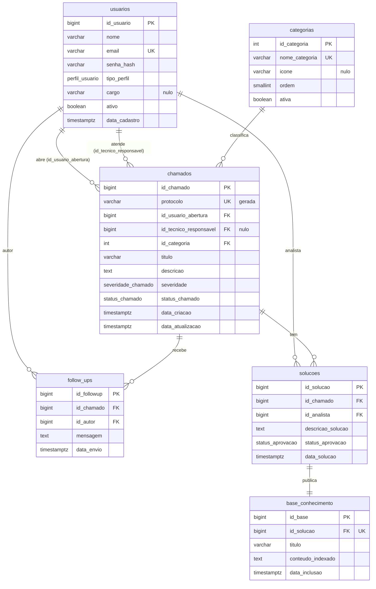

# Diagrama ER

Descreve o esquema **existente** no banco, criado pela migration `0001_esquema_inicial`
(seção 5.2 do prompt). Tabelas e colunas em português, iguais ao dicionário de dados do
Documento 02. Chaves primárias são `IDENTITY` (`BIGINT`, exceto `categorias`, que é `INT`);
datas em `TIMESTAMPTZ`; FKs com `ON UPDATE CASCADE ON DELETE RESTRICT`.

Tipos ENUM nativos: `perfil_usuario`, `severidade_chamado`, `status_chamado`,
`status_aprovacao`. A coluna `chamados.protocolo` é gerada (`TK-` + id com no mínimo 4 dígitos).

## Invariantes no banco (defesa em profundidade)

- `usuarios`: `uq_usuarios_email` (único) e `ck_usuarios_email_minusculo` (`email = lower(email)`).
- `chamados`: `ck_chamados_titulo_preenchido`, `ck_chamados_descricao_tamanho` (1 a 500),
  `ck_chamados_rn03_tecnico` (status `ATRIBUIDO`/`CONCLUIDO`/`FECHADO` exige técnico — RN03).
- `solucoes`: `descricao_solucao` não vazia e índice único parcial `uq_solucoes_uma_pendente`
  (no máximo uma solução `PENDENTE_APROVACAO` por chamado).
- `base_conhecimento`: `uq_base_conhecimento_solucao` (uma entrada por solução).

## Índices

- `chamados`: `uq_chamados_protocolo`, `ix_chamados_solicitante_data`,
  `ix_chamados_tecnico` (parcial), `ix_chamados_status_data`, `ix_chamados_categoria` e
  `ix_chamados_titulo_trgm` (GIN trigram sobre `f_unaccent(lower(titulo))`).
- `follow_ups`: `ix_followups_chamado_data`.
- `solucoes`: `ix_solucoes_chamado` e `uq_solucoes_uma_pendente`.

Extensões `pg_trgm` e `unaccent` e a função `IMMUTABLE f_unaccent(text)` dão suporte à busca por
título sem diferenciar acento (RNF02). A busca `tsvector` da Base de Conhecimento entra na F5.
