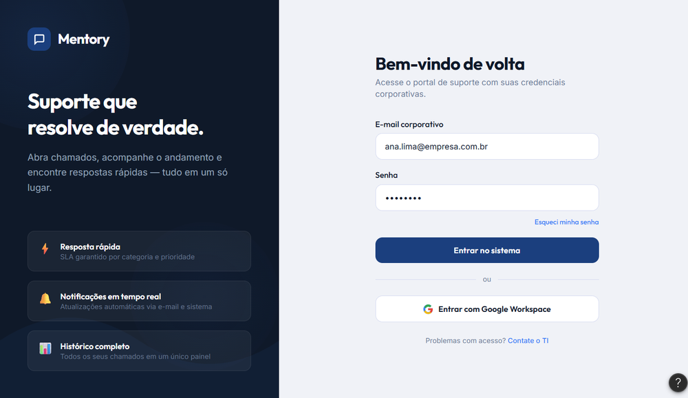
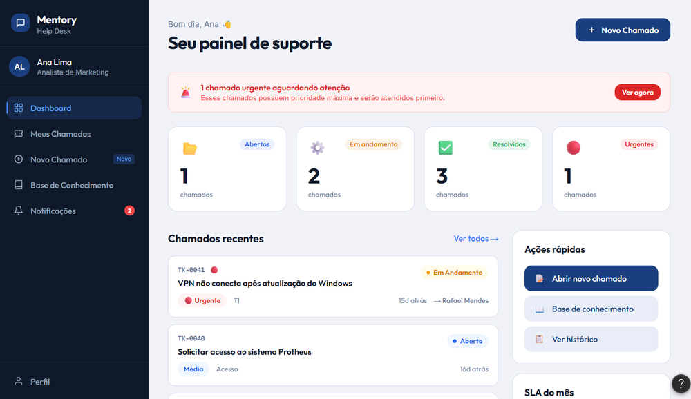
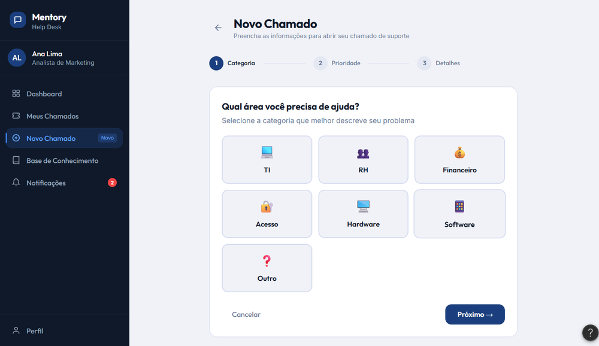
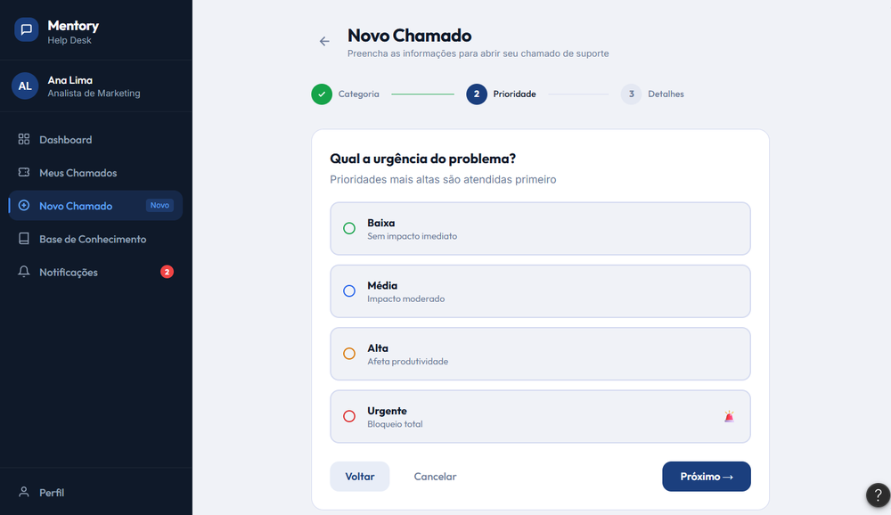
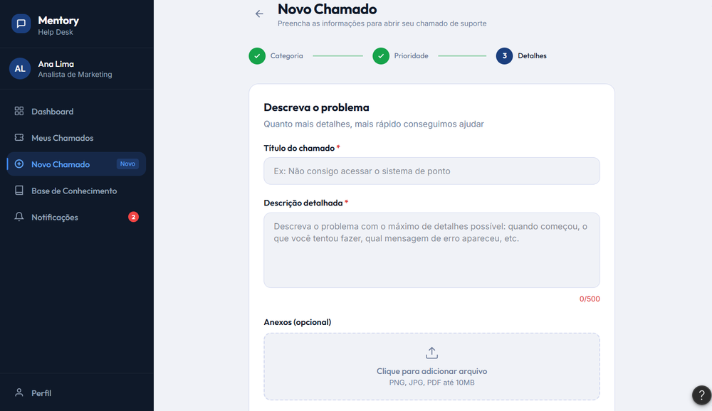
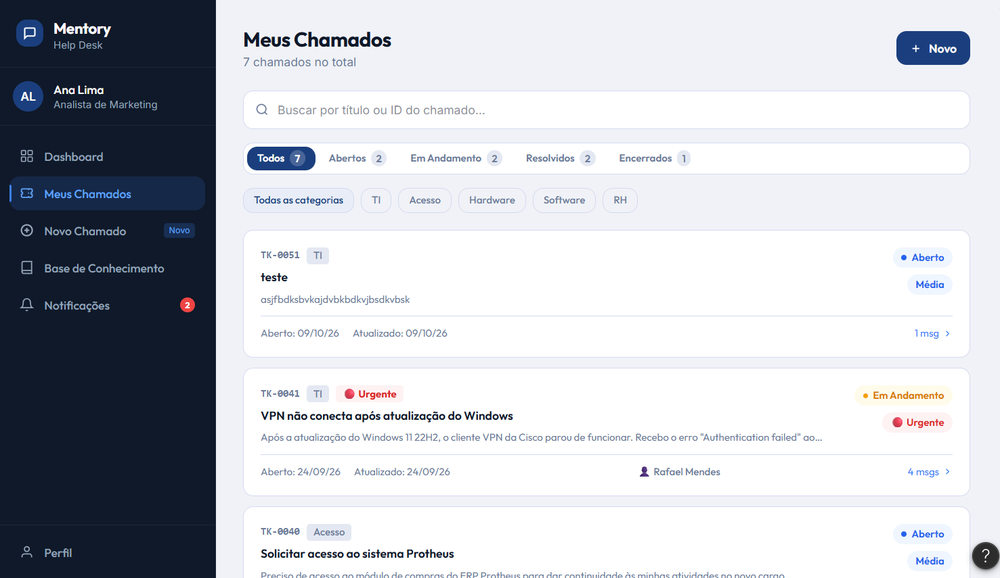

> Convertido do .docx original do grupo. Onde a stack técnica diverge, vale o `docs/PROMPT_IMPLEMENTACAO.md`; regras de negócio, telas e critérios de aceite deste documento continuam valendo.
>
> As capturas servem só como referência visual: o front-end é implementado do zero em React + TypeScript, sem depender do Figma.

*CENTRO UNIVERSITÁRIO NOSSA SENHORA DO PATROCÍNIO — CEUNSP (CAMPUS SALTO) — Curso: Ciências da computação — 3º / 4º Semestre — Disciplina: Análise e Projeto de Sistemas — Docente: Prof.ª Waldinelly Costa*

*PROTÓTIPO DAS TELAS PRINCIPAIS E FLUXO DE NAVEGAÇÃO — Entregável Prático: Wireframes \| User Journey \| DoD*

# DOCUMENTO 01: Protótipo das Telas Principais e Fluxo de Navegação

## Identificação do Projeto

- **Sistema:** Mentory Help Desk — Sistema de Chamados (portal de suporte corporativo para abertura, acompanhamento e resolução de chamados).

- **Perfis de acesso:** CLIENTE (usuário solicitante), ANALISTA (técnico) e ADMIN (administrador). O protótipo navegável representa a visão do perfil CLIENTE (usuária Ana Lima, Analista de Marketing).

- **Protótipo:** Figma Make — projeto “Help Desk User Journey” (https://www.figma.com/make/IcbJPX5CJ2hEela6cB3cLZ/Help-Desk-User-Journey).

## Telas Principais (Wireframes)

- **Wireframes:** esboços visuais estruturais das telas, de baixa/média fidelidade, que definem a organização da interface antes do desenvolvimento.

**1. Tela de Login / Autenticação (RNF01)**

- E-mail corporativo e senha, link “Esqueci minha senha”, botão “Entrar no sistema”, opção “Entrar com Google Workspace” e link “Contate o TI”.

- Painel lateral com os diferenciais do portal: resposta rápida com SLA, notificações em tempo real e histórico completo dos chamados.

**2. Dashboard (painel de controle com indicadores)**

- Saudação ao usuário, alerta de chamado urgente e quatro cartões de indicadores: **Abertos, Em andamento, Resolvidos e Urgentes**.

- Lista de chamados recentes (protocolo, severidade, categoria, responsável e tempo), ações rápidas (abrir chamado, Base de Conhecimento, histórico) e SLA do mês.

- Menu lateral: Dashboard, Meus Chamados, Novo Chamado, Base de Conhecimento, Notificações e Perfil.

**3. Tela de Cadastro de Chamados — formulário dinâmico em 3 etapas (RF02, RF05)**

- **Etapa 1 — Categoria:** TI, RH, Financeiro, Acesso, Hardware, Software e Outro.

- **Etapa 2 — Severidade:** Baixa (sem impacto imediato), Média (impacto moderado), Alta (afeta a produtividade) e Urgente (bloqueio total).

- **Etapa 3 — Detalhes:** título e descrição obrigatórios (descrição com contador de 500 caracteres) e anexos opcionais (PNG, JPG ou PDF até 10 MB). Botões Voltar, Cancelar e Próximo, com indicador de progresso.

**4. Telas de apoio**

- **Meus Chamados (RF03, RF04):** busca por título ou protocolo, abas por status com contadores (Todos, Abertos, Em andamento, Resolvidos, Encerrados), filtro por categoria e cartões com protocolo (ex.: TK-0041), severidade, responsável, datas e número de mensagens.

- **Base de Conhecimento (RF06):** busca, filtro por categoria e artigos em acordeão, com botão para abrir um chamado quando a resposta não resolve.

- **Notificações:** avisos de atualização dos chamados, com contador no menu lateral.

## Capturas do Protótipo (Figma Make)

## Equivalência de Termos (Protótipo × Modelagem)

Os rótulos exibidos no protótipo correspondem aos valores definidos no levantamento de requisitos e no modelo de dados:

- **Status:** Aberto = NOVO / PENDENTE; Em andamento = ATRIBUIDO; Resolvido = CONCLUIDO; Encerrado = FECHADO.

- **Severidade:** Baixa = BAIXA; Média = MEDIA; Alta = ALTA; Urgente = CRITICO.

- **Categorias:** o protótipo oferece TI, RH, Financeiro, Acesso, Hardware, Software e Outro; elas são cadastradas na tabela CATEGORIAS e podem ser ampliadas sem alterar o código.

## Fluxo de Navegação (User Journey)

- **User Journey (Jornada do Usuário):** caminho percorrido pelo usuário desde o acesso até a conclusão de uma tarefa.

**UJ01 — Abrir um chamado de suporte e acompanhar o atendimento** (UC02 e UC03). Ator: Usuário / Cliente.

**Pré-condição:** usuário previamente cadastrado (UC01) e com acesso ativo.

**Passo 1 (Ator):** Acessa o portal, informa e-mail corporativo e senha (ou escolhe Google Workspace) e aciona “Entrar no sistema”.

**Passo 2 (Sistema):** Valida as credenciais e redireciona o usuário ao Dashboard.

**Passo 3 (Ator):** Consulta os indicadores e, pelo menu lateral, escolhe “Novo Chamado” (ou “Base de Conhecimento”, para tentar o autoatendimento).

**Passo 4 (Ator):** Etapa 1 — seleciona a categoria e aciona “Próximo”.

**Passo 5 (Ator):** Etapa 2 — seleciona a severidade e aciona “Próximo”.

**Passo 6 (Ator):** Etapa 3 — preenche título e descrição, anexa arquivo se necessário e envia o chamado.

**Passo 7 (Sistema):** Valida os campos, registra o chamado no estado inicial “Novo”, vinculado ao usuário e à categoria, e exibe o protocolo (ex.: TK-0051).

**Passo 8 (Ator):** Em “Meus Chamados”, consulta o chamado com busca e filtros em tempo real e acompanha status e mensagens (follow-ups).

**Fluxos alternativos / exceções**

- **FA01 — Autoatendimento:** o usuário encontra a resposta na Base de Conhecimento e não abre chamado.

- **FA02 — Esqueci minha senha:** o usuário usa o link de recuperação na tela de login.

- **FE01 — Credenciais inválidas:** o sistema informa o erro e mantém o usuário na tela de login.

- **FE02 — Campos obrigatórios ausentes:** o sistema destaca título e descrição e bloqueia o envio.

- **FE03 — Cancelar / Voltar:** o rascunho é descartado e o usuário retorna ao Dashboard (ou à etapa anterior).

**Pós-condição:** chamado registrado no estado “Novo”, visível em “Meus Chamados” e contabilizado nos indicadores do Dashboard.

## Rastreabilidade (Telas × Requisitos × Casos de Uso)

- **Login:** RNF01 (HTTPS) e UC01 (perfis de acesso).

- **Dashboard:** RNF02 (resposta em até 2 s) e RNF03 (responsivo, desktop e celular).

- **Novo Chamado:** RF02, RF05, RN04 e UC02.

- **Meus Chamados e Notificações:** RF03, RF04 e UC03.

- **Base de Conhecimento:** RF06, RN05 e UC04.

## Critérios de Aceitação (Definition of Done)

- **Definition of Done — DoD (Definição de Pronto):** condições que um item deve cumprir para ser considerado concluído.

- As telas de Login, Dashboard e Novo Chamado estão prototipadas e navegáveis, e o fluxo Login → Dashboard → Novo Chamado → Meus Chamados funciona do início ao fim.

- O formulário só avança de etapa com a seleção feita e não permite o envio sem título e descrição.

- Status e severidades têm identidade visual consistente (selos coloridos) em todas as telas e seguem a equivalência de termos acima.

- **UX/UI (User Experience / User Interface):** foco na experiência e na interface intuitiva — paleta azul-marinho, menu lateral escuro, tipografia Outfit + Inter e layout responsivo (mobile-first) para desktop e celular.

- O protótipo foi apresentado ao Product Owner (PO) e os ajustes pedidos foram registrados no backlog.

## Ferramentas Utilizadas

- **Figma / Figma Make:** softwares colaborativos de design e prototipagem de telas; o protótipo foi gerado e refinado no Figma Make (“Help Desk User Journey”).

- **Draw.io / Lucidchart:** diagramas de apoio (fluxo e DER), conforme a modelagem do projeto.
